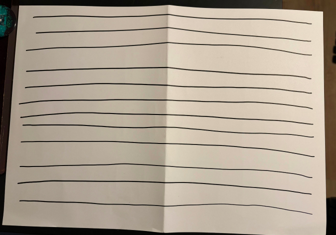
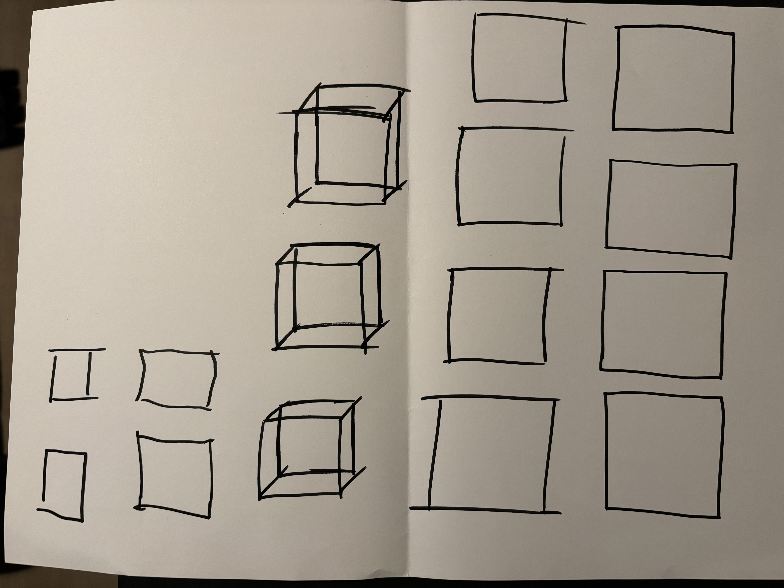
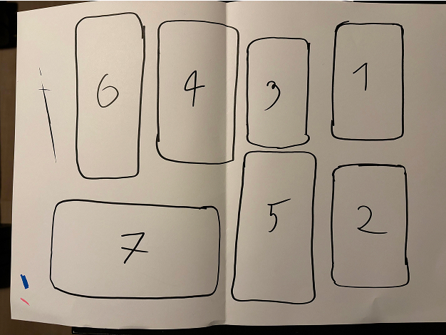
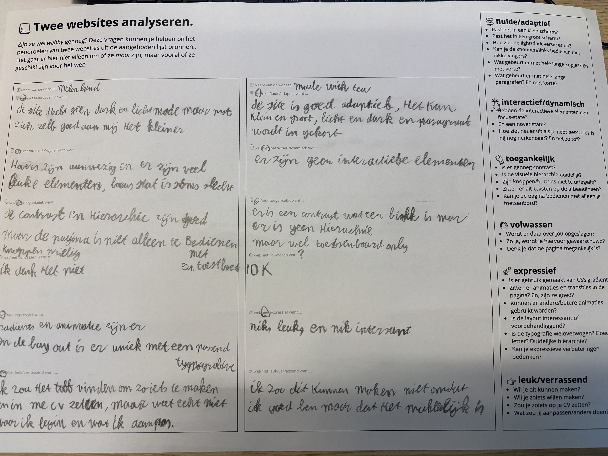
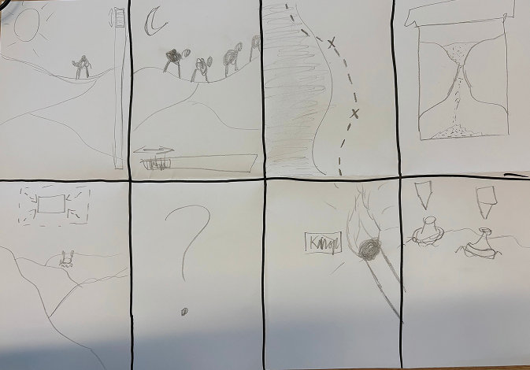
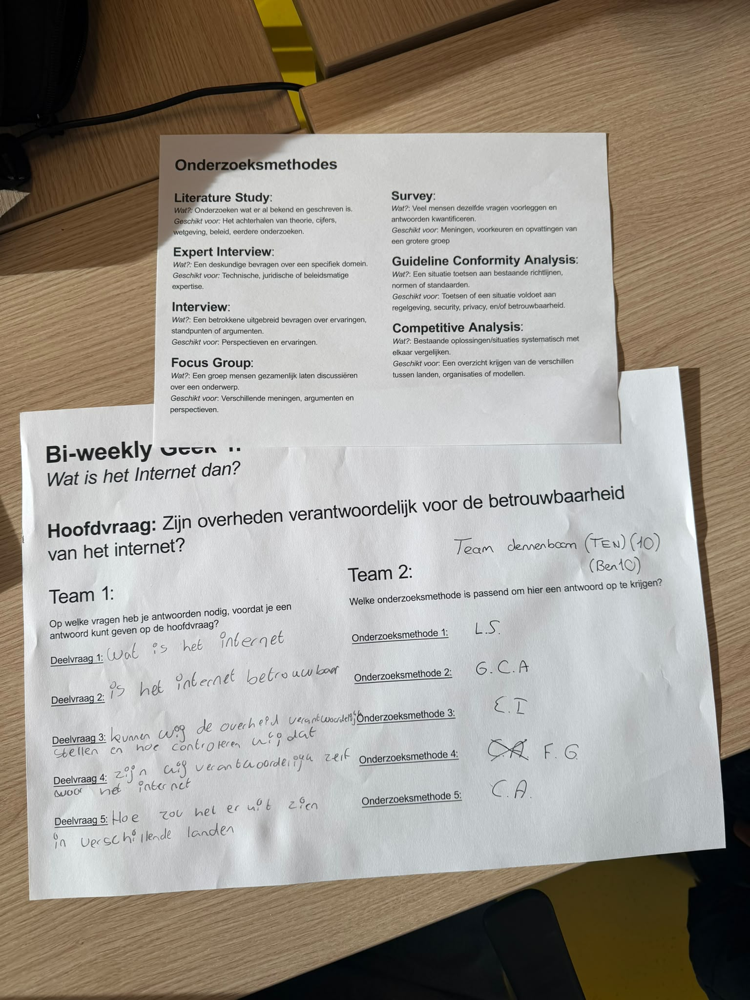
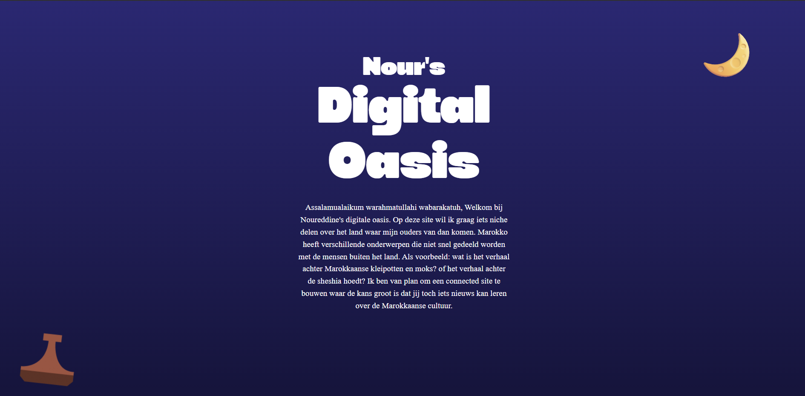
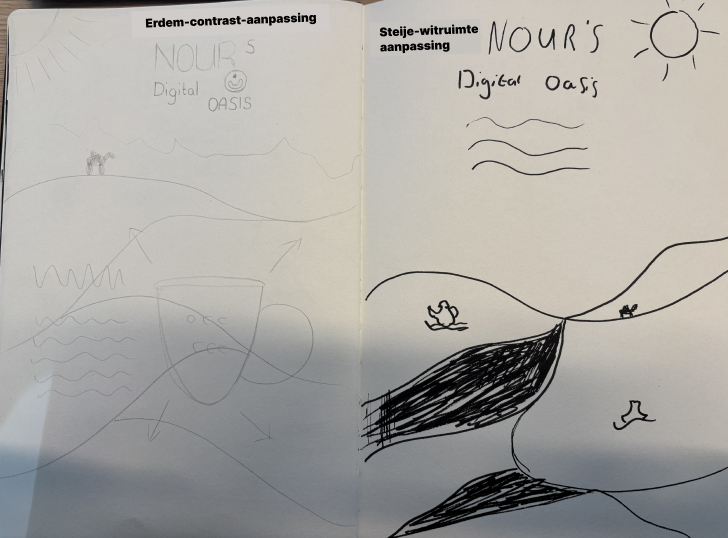
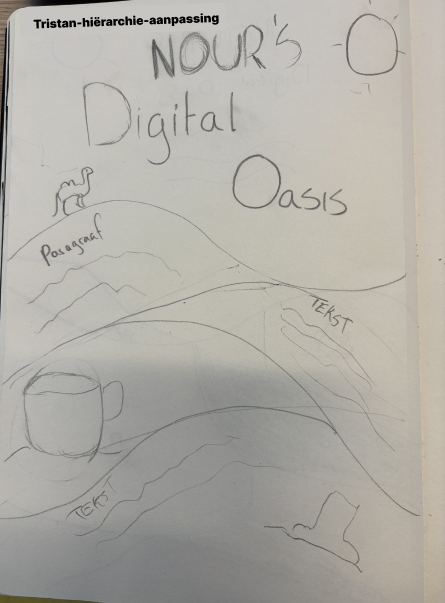
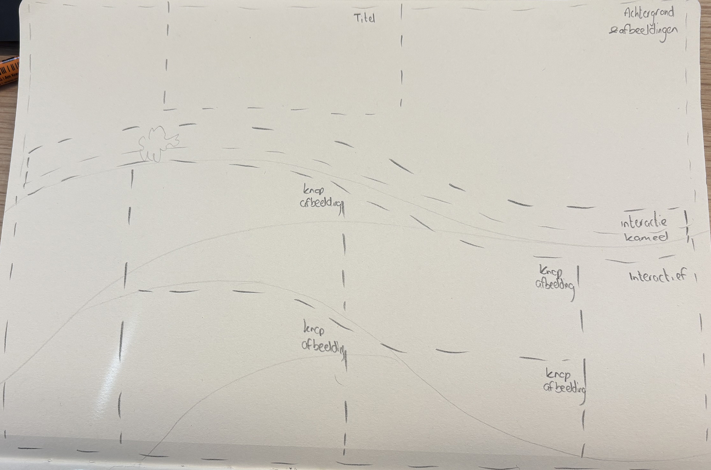

# 09/11/2026

**De checkout vragen voor vandaag:**

_Leg uit wat een source hosting platform is en voor welke jij gekozen hebt:_ GitHub

_Vertel welke domeinnaam jij gekozen hebt en hoe je die hebt gekoppeld aan jouw pagina:_ Ik heb de naam nour-s-digital-garden gekozen voor mij en de site gekoppeld met Transip.

_Beschrijf hoe je aanpassingen aan jouw pagina kunt maken en hoe je er voor zorgt dat die op het web gepubliceerd worden:_ aanpassingen worden uitgevoerd via VScodium en gepubliceerd via GitHub.

# 11/11/2026

**interactie:**
Vandaag hebben we een herhaling gekregen van een aantal principes van Multi Model Design en Micro-Interacties. en daarna hadden we formulieren behandelen. Uiteindelijk was er een uitdaging/opdracht om een fysieke menukaart naar een middelgroot scherm (laptop/tablet) te vertalen van Wok to Go. tekeningen schetsen, Figma te gebruiken en HTML/CSS waren allemaal mogelijk.
Ik heb een low-fi-schets gemaakt voordat ik een high-fi-figma-schets maakte

.jpg>)

**Schetsen:**
Tijdens de schetsenles hebben we verhelderende onderwerpen behandeld.
_Schets principes:_ Van low-fi naar hi-fi, Low-fi-tekst, Low-fi-plaatjes uittekken, Tekst eerst bij knoppen,Schaduw, Highlight met een kleur, annotaties in een andere kleur.

_Rangschikken:_ Erdem en ik hebben oude schetsen van Erdem lopen rangschikken en besproken waarom sommige schetsen goed zijn en sommige minder goed.

_Schetsoefeningen:_ lange rechte lijnen, dikke grote vierkanten, eigen mobiel op ware grootte.

_Opdracht Maak een mi-fi-schets:_ Ik heb twee mi-fi-schetsen gemaakt van de mobiele app van Steam
.jpg>)

_Animaties schetsen:_ We hebben uitleg Geiringer hoe je animaties kan schetsen en zelf een animatie moet bedekenen voor de menukaart opdracht en uitschetsen

# 13/11/2026

**Praktische CSS:**
Tijdens deze les hebben we een HTML-pagina aangemaakt. Een pagina leesbaar maken door middel van regellengte en lettertype aan te passen. Ook meer bruikbaarheid maken met plaatjes in toom houden en buttons een handje geven. Hiërarchie ook aangepast door de witteruimtes en font sizes.

.png>)
.png>)

**CSS: fonts met kleur en effecten:**
Tijdens deze les zijn we verdergegaan met coderen in CSS en meerdere opdrachten uitgevoerd. zoals het font, de kleuren en het grote aantepassen van een stuk tekst. maar daarvoor kregen we uitleg over wat web-safe fonts zijn en hoe we webfontservices & @font-face gebruiken.
.png>)
.png>)
.png>)

# 16/11/2026

Vandaag hebben we de meest en minst webby-site geanalyseerd in een groep van een lijst vol met sites. Ook hebben we een artikel gelezen over het concept van digitale gardens. Wat is een digitale gardens? Wat was het allererste? en wat is de verschil tussen 1 en een reguliere site? ook heb ik een begin gemaakt aan Opdracht 3 – verzamelen van inspiratie, en Practicum Light & Dark theme.

**De checkout vragen voor vandaag:**

_Leg uit wat een digital garden is en waarom dat anders is dan een reguliere website:_ Een digital garden is een site waar de eigenaar zijn hobby's en interesses wellicht verzamelt met connecties aan elkaar. in een en het concept van stream is afwezig.

_Leg uit wat een website 'webby' maakt en welke websites jou het meeste inspireren.:_ als de site aan deze punten bevat: Apatief, interactief, toegankelijk, volwassen en expressief. en tot nu toe inspireert Melonland mij het meest.

_Vertel waar jij mee aan de slag wilt gaan bij het maken van jouw eigen digital garden (let op: dit zijn jouw eerste ideeën, dit kan en mag veranderen in de loop van het programma.:_ Mijn idee is om wat Marokkaanse culturele dingen te delen.

# 17/11/2026

**Presentatie voorbereiden:**
Ik heb vandaag mijn digital garden presentatie in html gemaakt.

.png>)
.png>)

**Practicum Light & Dark theme.**
het practicum was te doen, vooral nadat ik de uitleg goed en rustig doorname. ik heb gelijk wat aanpassingen gemaakt aan mijn digital garden.

.png>)
.png>)
.png>)
.png>)
.png>)

# 18/11/2026

Vandaag hebben we onze presentatie gegeven aan een medestudent. Ik heb tijdens het presenteren lopen sparen over mijn idee en wat ik er nog bij kan hebben. zoals Dynamise scroll en een lichtbron hebben voor de dark mode.
Na de presentatie hebben JOUW VISUAL RESEARCH over ons onderwerp. Hier en bij de crazy 8 oefening heb ik een beter beeld gekregen van wat ik wil maken.

.png>)
.png>)

_Wat is voor jou de essentie van wat je hebt gepresenteerd qua onderwerp en geschreven/beeldende content?:_ kleuren, font en vorm van hoe ik de site graag wil zien. zoals Dynamise scroll

_Heeft 'de ander' een aanvulling op je onderwerp?​:_ Dynamise scroll zoals van links naar rechts of inzoomen. Dark mode een torch geven.

_Wat is het karakter/ de uitstraling/ het gevoel dat bij het onderwerp past? (bijv. stoer, hip, vrolijk, dynamisch, eenvoudig, enz.):_ sahara/nomand avondtuur vibes

_Welke inspiratie kun je uit je 25 afbeeldingen halen. Stijl, een gevoel, vorm, enz:_
vooral de moodboard Afbeeldingen. die geven het gevoel die ik wil berijken.

**Een stip op de horizon​:**
_Wat zou je willen vertellen over het onderwerp aan een ander?:_ Over wat Marokko allemaal heeft.
en hoe zou je dat voor je kunnen zien? Paginas met feiten over verschillende onderwerpen.

Ik wil mijn Digital Garden laten gaan over Niche infomatie over Marokko.
en wil dat laten zien door beelden van marokko. aan content te tonen.
Ik begin met een stukje eigen content over waar de Digital Garden over gaat. ​
Als het begin is gemaakt kan ik mijn Garden verder uitbreiden door de verschillende pagina's te uitbreiden

**Bespreek in duo's crazy 8**

_Wat zijn de beste ideeën en waarom? ... en waarom de andere minder?_ schets 1, 2 en 5, omdat die schetsen gelijk een functie gebruiken van een site

_Zijn uitgangspunten terug te zien in de schetsen? Hoe is dat zichtbaar?_ Ik denk het?

_Is het idee online te vertalen? Hoe zouden vorm/ kleur of typografie in een schermontwerp kunnen worden getoond?_ Volgens mijn docenten is het idee dat ik het zeer zeker kan vertalen, maar het kan uitdagend zijn als ik het ingewigeld maak.

_Is het idee expressief? Zit er genoeg uitdaging is? Ga je hiermee nieuwe CSS technieken leren? Zie je animaties of transities voor je?_ Mijn idee heeft veel potentie en ik denk wel dat ik niet te groot moet denken om het haalbaar te maken.

_Is het idee leuk en verrassend? Heb je zin om 'dit ontwerp' te maken?_ Ik ben erg enthousiast om mijn idee in realiteit te maken.

**De checkout vragen voor vandaag:**

_Leg uit waar het Visual Research in 3 stappen naartoe werkt: STAP 1:_ DIRECTE VISUELE BEELDEN > STAP 2: ABSTRACTE VISUELE VERTALING > STAP 3: UITGANSPUNTEN OPSCHRIJVEN.

_Vertel in 2 zinnen waar jouw Garden over gaat, en met welke content je dat gaat doen (beeld, tekst, sound, animatie enz).:_ Ik wil mijn Digital Garden laten gaan over Niche infomatie over Marokko. met foto's, uitleg tekst en muziek.

_Vertel kort welk idee van de Crazy 8 je het liefst zou willen uitvoeren/ verder zou willen onderzoeken.:_ Ik wil graag het dynamise scrollen idee van schets 1,2 en 5 verder uitvoeren.

Ik heb ook het practicum mooie kleuren en gradients gedaan. Dit practicum was zeer zeker te doen. Ik ben tevreden met wat ik heb geleerd over kleuren en gradients in CSS.

.png>)
.png>)
.png>)

# 19/11/2026

**Mini-Styleguide, mobile-first schetsen**

Vandaag heb ik een tot nu toe min stylegude gemaakt voor mijn digitale garden en wat low- en hi-fi-schetsen.

# 20/11/2026

_Welke feedback heb je gehad?_
Ik heb als feedback gekregen van mijn docenten dat ik gebruik kan maken van een atmosferisch perspectief. met lagen werken. Als je over een specifieke duin hoverert, dan pas zie je het onderwerp. Daarom ben ik nu van plan om het verticale scroll-idee verder uit te werken. Met deze feedback kan ik zeker iets leuks doen en veel leren over wat er allemaal te doen is in HTML, CSS.

**Practicum Grid 101 + Media queries 101**

Tijdens dit practicum heb ik veel geleerd over hoe grids werken en wat je er allemaal mee kan doen. Ook ik heb geleerd hoe ik een grid responsive maak voor desktop en mobiele telefoon. Vergeleken met de vorige practicums vond ik deze veel sneller en beter gaan. Dit zou kunnen komen door het feit dat ik steeds beter word in het coderen van HTML en CSS.

.png>)

# 23/11/2026

**Bi-weekly geek 1**
Vandaag hebben we iets gedaan met de Bi-weekly. we hebben als team een hoofdvraag gekregen waar we deelvragen moesten verzinnen. Nadat hadden we onderzoeksmethodes gekoppeld aan deelvragen van een ander team.

Ik heb tot nu toe de stoffen van Practicum dark and light mode en gradiant toegepast in mijn digital garden. (de maan is de dark en light mode knop)

**De checkout vragen voor vandaag:**

_Leg uit wanneer een website 'lelijk' wordt en geef voorbeelden wat je kan doen om deze 'lelijke' onderdelen te fixen?:_ Als de tekst van de site telang horizontaal wordt, en je kan dat fixen door de tekst responsive te maken op basis van hoe groot je scherm is

_Vertel welke volgende stap je neemt om je website responsive te maken.:_ Door via inspect te kijken hoe mijn site eruitziet voor mobielen, telefoon en met die aanpassingen te maken hoe groot content moet zijn.

_Kun je het ontwerp en de bouw van je eigen Garden (zo uit je hoofd) onderbouwen in Webby vocabulair?:_ Niet alles, maar wat ik wel weet uit mijn hoofd van Webby is dat mijn site adept op of je dark of light mode aan hebt en hoe groot je scherm is.

# 24/11/2026

Ik heb vandaag het practicum Everything Images uitgevoerd. Dit practicum ging soepel en snel. komt vast doordat ik coderen steeds beter snap en dat dit practicum wel simpel was.

.png>)
.png>)

Tijdens het practicum kwam ik op het idee om sterrenachtergrond te maken in Figma en die als een svg in CSS te plaatsen. Deze achtergrond is alleen te zien in de dark mode.
.png>)

# 25/11/2026

**workshop 5 Ontwerptheorie**

Vandaag hebben we een opfrissing gekregen over de Gestalt-theorie en ontwerpprincipes. Door deze principes toe te passen, kan ik mijn digital garden verbeteren. Voordat ik daarmee aan de slag ging, hebben we in een groep opdrachten gedaan met schermschetsen. Steeds kreeg iedereen de schets van een ander, waarna ik aanpassingen moest doorvoeren op het gebied van contrast, witruimte of hiërarchie.

**De checkout vragen voor vandaag:**

_Noem 3 Gestalt- of Design principes op en laat de ander uitleggen wat ze betekenen en doen._
Symmetrie = elementen netjes gespiegeld hebben, geeft order en vast gevoel
contrast = overduidelijk andere grootte of kleur geeft aan dat dit element anders is dan het andere.
Sluiting = hersen van ons kunnen ontbreken en delen vullen als we genoeg van een vorm zien.

_Een grid biedt ruimte om te spelen (vrijheid), maar tegelijkertijd ook eenheid en structuur (vastigheid). Wat wordt hiermee bedoeld?_ Je bent vrij om de structuur aan te passen naar iets anders, maar het blijft een eenheid en/of structuur.

_Welk principe neem je mee in een laatste iteratie van je eigen Garden?_
visual hierarchy neem ik voor nu me.

# 26/11/2026
